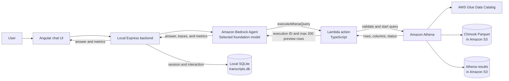

# Architecture

## Purpose

The system answers natural-language analytical questions over the Chinook music-store
dataset. An Amazon Bedrock Agent translates a question into read-only Athena SQL, invokes a
Lambda action, and explains the returned result.

## Request flow

## Components

### Data stack

`infra/athena.yaml` creates:

- a Glue database, `chinook` by default;
- a Glue crawler with one S3 target for each dataset table;
- an IAM role that lets the crawler read only the configured data prefix; and
- an Athena workgroup whose encrypted query results are written to the configured S3 prefix.

The S3 bucket itself is not created by the template. The deployment therefore depends on an
existing bucket. The crawler uses `CRAWL_NEW_FOLDERS_ONLY`; changes inside an existing table
folder may require a different recrawl strategy or a manual catalog update.

### Conversational-query stack

`infra/conversational-query-agent.yaml` creates:

- a Bedrock Agent defaulting to Nova Lite, with Nova Pro also allowed;
- an action group exposing the `executeAthenaQuery` function with one required SQL parameter;
- the built-in `AMAZON.UserInput` action group for returning clarification questions to the user;
- a Node.js 24, ARM64 Lambda function built from `src/lambda/`;
- least-privilege roles for model invocation and data access; and
- a deployable Bedrock Agent alias.

`infra/conversational-query-agent-haiku.yaml` contains the same resources and semantic agent
configuration for updating the existing stack to Claude Haiku 4.5. It fixes the model to the EU
Haiku inference profile and omits `TopP` while retaining `Temperature: 0`. Claude Haiku 4.5 does
not accept both sampling parameters in one request. The template deliberately preserves the stack
resource logical IDs and default agent name, while advancing the alias revision to publish the
corrected configuration.

The agent prompt contains the current schema and join guidance. It states that the query action is
already configured with the Glue and Athena infrastructure and asks one clarification question
only when different reasonable interpretations of the analytical request would materially change
the query. It may correct and retry an Athena error once.

Clarification uses Bedrock's built-in user-input action and ends the current turn without calling
the query Lambda. The application displays that question as the assistant response; the user's
next message continues the same Bedrock session.

### Local application and transcript store

The Angular chat sends a question and Bedrock session ID to the local Express endpoint.
`BedrockAgentClient` invokes the agent, while `BedrockResponseProcessor` decodes the streamed
answer and derives trace events, model metadata, token usage, orchestration metrics, and SQL
attempts. Before returning a successful response, the client commits the question, answer,
metrics, ordered trace events, and reproducibility metadata to
`src/backend/data/transcripts.db` through the SQLite transcript repository. Failed Bedrock
requests are recorded on a best-effort basis.

The transcript store is a local research-data boundary rather than part of the deployed AWS
stack. Its database and WAL files are ignored by Git. See
[`conversation-storage.md`](conversation-storage.md) for the schema, verification commands, and
privacy constraints.

Nova Lite remains the shared template's default. The dedicated Haiku template uses the documented
EU cross-Region inference profile and corresponding IAM permissions. Both conditions preserve the
same prompt, action contract, Lambda implementation, and dataset so the foundation model remains
the experimental variable; the omission of incompatible `TopP` is a model-required serialization
difference rather than an experimental prompt change.

### Lambda action

The handler performs four stages:

1. Extract the `query` property from the Bedrock action event.
2. Reject SQL without `SELECT` or containing a configured forbidden keyword.
3. Submit the query to Athena and poll until it succeeds, fails, or reaches the timeout.
4. Return the Athena query execution ID, named preview rows, preview row count, and a truncation
   flag to the agent.

Validation and Athena errors are returned as `REPROMPT` action results. This gives the model the
specific diagnostic for its one correction attempt; marking them as failed dependencies would
terminate the invocation before the model could retry.

The default timeout is 120 seconds and the action response is capped at 200 preview rows. This cap
does not add `LIMIT` to the SQL or truncate Athena's stored result. The benchmark evaluator uses
the query execution ID to paginate the complete original result before comparing it with the gold
result. The model-facing cap prevents large query results from consuming excessive context-window
space and input tokens, increasing inference latency and cost, or exceeding Bedrock/Lambda response
payload limits. It also leaves context available for the agent instructions, schema, conversation,
and any subsequent reasoning or retry. The Lambda timeout is 135 seconds, leaving a small margin
for request and response processing.

## Security boundaries

Safety is layered rather than delegated only to the model:

- the prompt instructs the model to produce read-only SQL;
- the Lambda applies lexical SQL validation;
- the Lambda role permits Athena operations only in the project workgroup;
- S3 access is scoped to the data and result prefixes; and
- the Glue role has read access to the relevant catalog resources.

The validator is not a complete SQL parser. It scans the upper-cased query for `SELECT` and
forbidden words, so words in comments or string literals can cause false positives, and complex
SQL grammar is not structurally analysed. A parser-based allow-list is a future hardening option.

## Deployment boundary

The infrastructure is deliberately split into two stacks. The data/catalog stack can be
created and populated before the conversational layer. The agent stack receives the Glue
database and Athena workgroup names as parameters. This reduces coupling, but deployments must
keep parameter values consistent across both stacks.
