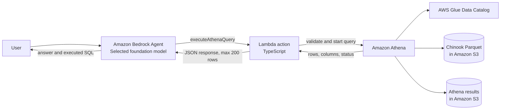

# Architecture

## Purpose

The system answers natural-language analytical questions over the Chinook music-store
dataset. An Amazon Bedrock Agent translates a question into read-only Athena SQL, invokes a
Lambda action, and explains the returned result.

## Request flow

## Components

### Data stack

`infra/athena.yaml` creates:

- a Glue database, `chinook` by default;
- a Glue crawler with one S3 target for each dataset table;
- an IAM role that lets the crawler read only the configured data prefix; and
- an Athena workgroup whose encrypted query results are written to the configured S3 prefix.

The S3 bucket itself is not created by the template. The deployment therefore depends on an
existing bucket. The crawler uses `CRAWL_NEW_FOLDERS_ONLY`; changes inside an existing table
folder may require a different recrawl strategy or a manual catalog update.

### Conversational-query stack

`infra/conversational-query-agent.yaml` creates:

- a Bedrock Agent using Amazon Nova Lite by default, with Nova Pro, Claude Haiku 4.5, and Claude
  Sonnet 4.5 also allowed;
- an action group exposing the `executeAthenaQuery` function with one required SQL parameter;
- a Node.js 24, ARM64 Lambda function built from `src/lambda/`;
- least-privilege roles for model invocation and data access; and
- a deployable Bedrock Agent alias.

The agent prompt contains the current schema and join guidance. It asks one clarification
question when a missing metric, filter, grouping, or time range would materially change the
query. It may correct and retry an Athena error once.

Nova Lite remains the current deployed default. The formal evaluation will also deploy equivalent
agent configurations using Claude Haiku 4.5 and Claude Sonnet 4.5. Those conditions must preserve
the same prompt, action contract, Lambda implementation, and dataset so the foundation model is
the experimental variable. Model availability and direct base-model access must be verified in the
chosen Region before the Claude conditions are collected; a required cross-Region inference
profile would need additional template and IAM support.

### Lambda action

The handler performs four stages:

1. Extract the `query` property from the Bedrock action event.
2. Reject SQL without `SELECT` or containing a configured forbidden keyword.
3. Submit the query to Athena and poll until it succeeds, fails, or reaches the timeout.
4. Return named rows, the executed SQL, row count, and a truncation flag to the agent.

Validation and Athena errors are returned as `REPROMPT` action results. This gives the model the
specific diagnostic for its one correction attempt; marking them as failed dependencies would
terminate the invocation before the model could retry.

The default timeout is 120 seconds and the returned result is capped at 200 data rows. The
Lambda timeout is 135 seconds, leaving a small margin for request and response processing.

## Security boundaries

Safety is layered rather than delegated only to the model:

- the prompt instructs the model to produce read-only SQL;
- the Lambda applies lexical SQL validation;
- the Lambda role permits Athena operations only in the project workgroup;
- S3 access is scoped to the data and result prefixes; and
- the Glue role has read access to the relevant catalog resources.

The validator is not a complete SQL parser. It scans the upper-cased query for `SELECT` and
forbidden words, so words in comments or string literals can cause false positives, and complex
SQL grammar is not structurally analysed. A parser-based allow-list is a future hardening option.

## Deployment boundary

The infrastructure is deliberately split into two stacks. The data/catalog stack can be
created and populated before the conversational layer. The agent stack receives the Glue
database and Athena workgroup names as parameters. This reduces coupling, but deployments must
keep parameter values consistent across both stacks.
