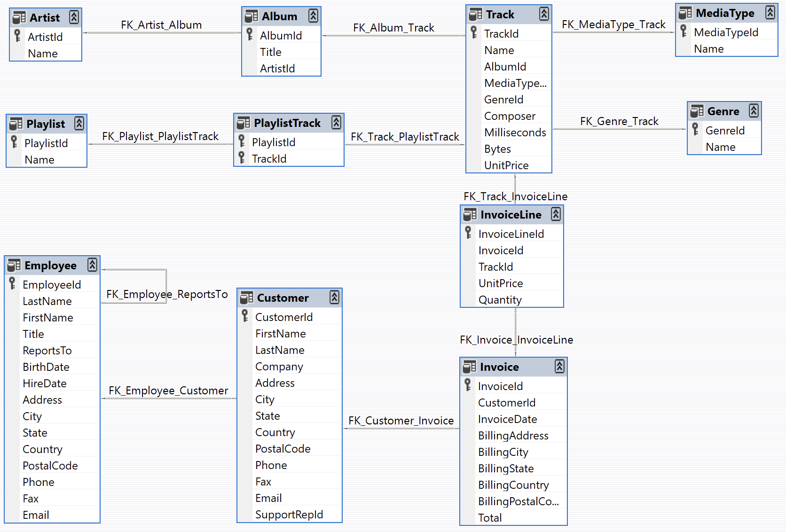

# Chinook dataset

## Scope

Chinook is a sample digital music-store database. It contains catalogue data (artists, albums,
tracks, genres, and media types), playlists, customers and employees, and sales represented by
invoices and invoice line items. In this project each table is stored as a Parquet file under a
separate S3 prefix and discovered by AWS Glue.

## Tables

| Table            | Primary identifier     | Purpose                                                  |
| ---------------- | ---------------------- | -------------------------------------------------------- |
| `artists`        | `artist_id`            | Artist names                                             |
| `albums`         | `album_id`             | Albums and their artists                                 |
| `tracks`         | `track_id`             | Track metadata, duration, size, and list price           |
| `genres`         | `genre_id`             | Genre lookup                                             |
| `media_types`    | `media_type_id`        | Audio/video format lookup                                |
| `playlists`      | `playlist_id`          | Playlist names                                           |
| `playlist_track` | composite relationship | Many-to-many playlist membership                         |
| `customers`      | `customer_id`          | Customer identity, location, and support representative  |
| `employees`      | `employee_id`          | Employees, managers, and employment metadata             |
| `invoices`       | `invoice_id`           | Sale header, customer, billing location, date, and total |
| `invoice_items`  | `invoice_line_id`      | Tracks, quantities, and prices sold on an invoice        |

## Relationships

_Schema diagram sourced from the
[original Chinook database repository](https://github.com/lerocha/chinook-database/tree/master)._

Join using the corresponding identifiers: `albums.artist_id = artists.artist_id`,
`tracks.album_id = albums.album_id`, `invoice_items.invoice_id = invoices.invoice_id`, and so
on. Athena folds unquoted identifiers to lowercase.

## Metric definitions

Use explicit metric definitions in experiments and answers:

- **Revenue**: normally `SUM(invoice_items.unit_price * invoice_items.quantity)`. `SUM(invoices.total)`
  is also valid for invoice-level analysis, but must not be summed after joining to line items
  without preventing duplicate invoice totals.
- **Units sold**: `SUM(invoice_items.quantity)` rather than the number of invoice-item rows.
- **Orders**: `COUNT(DISTINCT invoices.invoice_id)`.
- **Customers**: use `COUNT(DISTINCT customer_id)` when joins can duplicate customers.
- **Track duration**: `tracks.milliseconds`; convert explicitly when reporting seconds or minutes.
- **Catalogue price**: `tracks.unit_price`; realised line revenue should use
  `invoice_items.unit_price`.

## Analytical caveats

- The dataset is a sample, not a live commercial system; conclusions should demonstrate the
  method rather than claim external business validity.
- Billing geography belongs to an invoice and can differ from the customer's stored address.
- A track may occur in multiple playlists, so joining through `playlist_track` can duplicate it.
- Nullable fields such as company, state, composer, and manager require deliberate null handling.
- Date filtering should state whether interval endpoints are inclusive. Prefer half-open ranges,
  for example `invoice_date >= DATE '2012-01-01' AND invoice_date < DATE '2013-01-01'`.
- Glue infers the physical schema. Verify inferred data types after crawling, especially dates and
  numeric identifiers, before treating an experiment as reproducible.

## Suitable benchmark questions

The dataset supports catalogue lookups, ranked sales, time trends, geographic comparisons,
customer segmentation, employee/support analysis, and multi-hop questions such as revenue by
artist or genre. Evaluation examples are maintained in `evaluation.md` rather than embedded in
the agent prompt.
